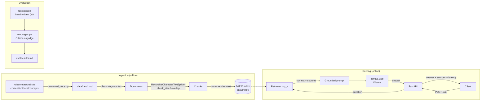

# rag-doc-assistant

[](https://github.com/eya-lakhal/rag-doc-assisatnt/actions/workflows/ci.yml)

Question-answering assistant over technical documentation, built on **RAG** (retrieval-augmented generation).
It answers questions about the **Kubernetes documentation** using **only** the indexed pages, cites its
sources, and says *"I don't know"* when the documentation does not cover the question.

**Stack**: LangChain · FAISS · Ollama (`llama3.2:3b` + `nomic-embed-text`) · FastAPI · Docker · Ragas · pytest · GitHub Actions.
100 % local and free: no paid API.

---

## Architecture



| Step | File | Role |
|---|---|---|
| Download | [`ingest/download_docs.py`](ingest/download_docs.py) | 80 Markdown pages from `kubernetes/website` (one GitHub API call + raw files, commit SHA recorded in `manifest.json`) |
| Index | [`ingest/build_index.py`](ingest/build_index.py) | Hugo cleaning (front matter, shortcodes), Markdown-aware splitting, embeddings, FAISS |
| RAG chain | [`app/rag.py`](app/rag.py) | top-k retrieval with scores, numbered context, strict prompt, LCEL `prompt \| llm \| parser` |
| API | [`app/main.py`](app/main.py) | `POST /ask`, `GET /health`, Swagger at `/docs` |
| Config | [`app/config.py`](app/config.py) | every parameter is an environment variable (`CHUNK_SIZE`, `TOP_K`, `LLM_MODEL`, ...) |
| Eval | [`eval/run_ragas.py`](eval/run_ragas.py) | Ragas: faithfulness, answer relevancy, context precision, context recall |

### Design choices

- **FAISS** (in-process, file on disk): no database server to run, enough for a few thousand chunks.
- **Ollama embeddings (`nomic-embed-text`)** instead of sentence-transformers: no PyTorch in the image
  (642 MB instead of ~2 GB), one single model server for the LLM and the embeddings.
- **Markdown-aware splitting**: separators `## ` → `### ` → paragraph → line → sentence, so chunks follow the page structure.
- **Grounding prompt**: answer only from the context, cite `[n]`, fixed "I don't know" sentence otherwise,
  temperature 0. Sources (file, title, excerpt, FAISS distance) are returned to the user so answers can be checked.
- **Index loaded once** at startup (FastAPI lifespan); the blocking LLM call runs in a thread pool.
  If the index is missing, the API still starts and `/health` reports `degraded` (`/ask` returns 503).

---

## Installation (Windows / PowerShell)

Requirements: Python 3.11, Docker Desktop.

```powershell
git clone https://github.com/eya-lakhal/rag-doc-assisatnt.git
cd rag-doc-assisatnt
python -m venv .venv
.\.venv\Scripts\Activate.ps1
pip install -r requirements-dev.txt
```

Start Ollama and pull the models (≈ 2.3 GB):

```powershell
docker compose up -d ollama
docker compose exec ollama ollama pull llama3.2:3b
docker compose exec ollama ollama pull nomic-embed-text
```

## Usage

### 1. Ingestion

```powershell
python -m ingest.download_docs --max-files 80

# Compare chunking strategies (no embedding, instant)
python -m ingest.build_index --stats-only --chunk-size 500 --chunk-overlap 75
python -m ingest.build_index --stats-only --chunk-size 1000 --chunk-overlap 150

# Build the indexes (≈ 8 min each on CPU)
python -m ingest.build_index --chunk-size 1000 --chunk-overlap 150 --out data/index/default
python -m ingest.build_index --chunk-size 1000 --chunk-overlap 150 --out data/index/chunk1000
python -m ingest.build_index --chunk-size 500  --chunk-overlap 75  --out data/index/chunk500
```

| chunk_size / overlap | Chunks | Mean length | Median length |
|---|---|---|---|
| 500 / 75 | 3 268 | 322 chars | 350 chars |
| 1000 / 150 | 1 613 | 659 chars | 711 chars |

### 2. API

Locally:

```powershell
uvicorn app.main:app --reload
```

or with Docker (API + Ollama):

```powershell
docker compose up -d --build
```

Swagger UI: <http://localhost:8000/docs>

```bash
curl -X POST http://localhost:8000/ask \
  -H "Content-Type: application/json" \
  -d '{"question": "What are the possible values of concurrencyPolicy in a CronJob?"}'
```

PowerShell:

```powershell
Invoke-RestMethod -Method Post -Uri http://localhost:8000/ask -ContentType "application/json" -Body '{"question": "What are the possible values of concurrencyPolicy in a CronJob?"}'
```

Real response (abridged):

```json
{
  "question": "What are the possible values of concurrencyPolicy in a CronJob?",
  "answer": "According to [1], the possible values of `.spec.concurrencyPolicy` in a CronJob are:\n* `Allow`: The CronJob allows concurrently running Jobs.\n* `Forbid`: The CronJob does not allow concurrent runs; [...] the CronJob skips the new Job run.\n* `Replace`: [...] the CronJob replaces the currently running Job run with a new Job run.",
  "sources": [
    {"file": "workloads/controllers/cron-jobs.md", "title": "CronJob", "excerpt": "...", "score": 0.379},
    {"file": "workloads/controllers/cron-jobs.md", "title": "CronJob", "excerpt": "...", "score": 0.495}
  ],
  "latency_ms": 428071.1,
  "model": "llama3.2:3b"
}
```

Out-of-scope question (`"How do I bake a chocolate cake?"`) → `"I don't know: the documentation I have access to does not cover this question."`

### 3. Tests and lint

```powershell
ruff check .
ruff format --check .
pytest --cov=app --cov=ingest
```

The tests use a deterministic fake embedding model and a fake chat model, so they need **no Ollama server**
(this is what runs in CI). They cover cleaning/chunking, retrieval ranking, the "I don't know" path,
index save/load, and the API (200, 422 validation, 503 without index, 502 when the LLM fails, Swagger).

CI ([`.github/workflows/ci.yml`](.github/workflows/ci.yml)): ruff → pytest with coverage → Docker build + smoke test of `/health`.

### 4. Ragas evaluation

```powershell
python -m eval.run_ragas              # 26 questions x 2 configurations
python -m eval.run_ragas --limit 10   # subset (what was run below)
```

- [`eval/testset.json`](eval/testset.json): 26 questions written by hand from the corpus, each with a reference answer and its source page.
- Judge: the same local `llama3.2:3b` model through Ollama, embeddings `nomic-embed-text`.
- Compared configurations: **chunk_size 500 vs 1000**, same `top_k = 3` (only one variable changes).

<!-- RAGAS:START -->
_Results: see [`eval/results.md`](eval/results.md)._
<!-- RAGAS:END -->

---

## Limitations and possible improvements

- **Latency on CPU**: ~2-3 min per answer on a laptop CPU in Docker (6 vCPU), plus several minutes the first time
  the model is loaded. A GPU (see the commented block in `docker-compose.yml`) or native Ollama brings it to a few seconds.
- **Small judge**: a 3B model is a weak Ragas judge (sometimes invalid JSON → `NaN`, noisy scores). The evaluation was
  run on a 10-question subset because of CPU time. A bigger judge (e.g. `qwen2.5:14b`) and the full test set would
  give more reliable numbers.
- **Retrieval**: pure dense search. Improvements: hybrid BM25 + vectors, a cross-encoder re-ranker, MMR for diversity,
  a similarity threshold to refuse earlier.
- **Corpus**: 80 pages of `concepts/` only; an incremental re-indexing job would be needed to follow doc updates.
- **Production**: no authentication, rate limiting or streaming of the answer; `langchain-community` (FAISS wrapper) is being
  sunset by LangChain and should be replaced by a standalone integration.

## Corpus license

The documentation in `data/raw/` (not committed) comes from [kubernetes/website](https://github.com/kubernetes/website),
© The Kubernetes Authors, licensed under [CC BY 4.0](https://creativecommons.org/licenses/by/4.0/).
The pages are cleaned (Hugo syntax removed) and split into chunks before indexing. The exact commit is recorded in
`data/raw/manifest.json`.

The code of this repository is under the MIT license.
